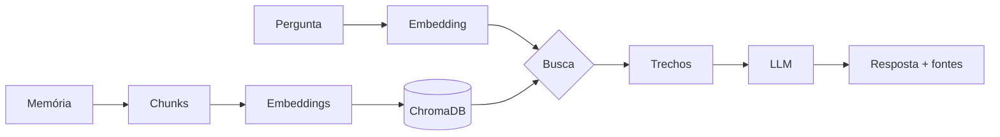

# 🧠 Segundo Cérebro

Um **RAG sobre a minha vida pessoal**, criado para aprender IA na prática. O plano é evoluir o
projeto para LLM local e fine-tuning e, depois, levar o aprendizado para a empresa.

- 📖 **[Guia de conceitos](docs/conceitos.md)**: como tudo funciona, sem precisar ler código
- 🗺️ **[Roadmap](docs/roadmap.md)**: próximas fases

## Como funciona

Dois chats:

1. **✍️ Alimentar:** você escreve memórias e fatos da sua vida. Cada texto é quebrado em
   *chunks*, transformado em *embeddings* (vetores de significado) e guardado num banco vetorial.
2. **💬 Perguntar:** você faz uma pergunta. O sistema busca os trechos mais parecidos e um LLM
   responde **só com base nas suas memórias**, citando as fontes.



## Stack

| Peça | Escolha | Por quê |
|------|---------|---------|
| Embeddings | `sentence-transformers` + `multilingual-e5-small` | Local, grátis, entende português |
| Banco vetorial | ChromaDB | Local, sem servidor |
| LLM | Claude (API) ou Ollama (local) | Troca pelo `.env` |
| Interface | Streamlit | UI simples em Python |

## Como rodar

```bash
python -m venv .venv
source .venv/bin/activate              # Windows: .venv\Scripts\activate
pip install -e ".[dev]"
cp .env.example .env                   # coloque sua ANTHROPIC_API_KEY
```

**Interface (os dois chats):**
```bash
streamlit run app/streamlit_app.py
```

**Ou pelo terminal:**
```bash
cerebro adicionar "Tenho uma cachorra chamada Mel, adotada em 2020." -c família -d 2020
cerebro buscar "qual o nome do meu pet?"       # mostra só o que a busca encontrou (sem LLM)
cerebro perguntar "qual o nome do meu pet?"    # RAG completo
cerebro status
cerebro reindexar                              # reconstrói o índice (ex.: após mudar o chunk)
```

Na primeira execução, o modelo de embeddings (~470 MB) é baixado automaticamente.

## Estrutura

```
src/segundo_cerebro/
├── chunking.py     # 1. quebra textos em pedaços
├── embeddings.py   # 2. texto → vetor
├── store.py        # 3. banco vetorial (guardar e buscar)
├── memorias.py     # fluxo "Alimentar": salvar + indexar
├── llm.py          # 4. Claude ou Ollama
├── rag.py          # fluxo "Perguntar": buscar → montar prompt → gerar
├── config.py       # configurações (.env)
└── cli.py          # comandos de terminal
app/streamlit_app.py   # interface com as duas abas
data/                  # SEUS DADOS (ignorado pelo git)
```

## Privacidade

- `data/` e `.env` estão no `.gitignore`: memórias e chaves **nunca** vão para o GitHub.
- Embeddings e banco vetorial rodam **localmente**.
- Com `LLM_PROVIDER=anthropic`, os trechos recuperados em cada pergunta **são enviados** à API
  do Claude. Para manter tudo 100% local, use `LLM_PROVIDER=ollama`.
