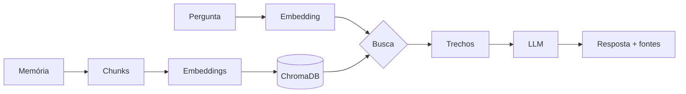

# 🧠 Lembra

**App de organização da vida pessoal com IA.** Você registra memórias, finanças, compromissos e
família, e conversa com um assistente que responde com base no que você mesmo registrou.

Também é um laboratório para dominar IA na prática (RAG, agentes, LLM local, fine-tuning).
Visão completa em [docs/visao-do-produto.md](docs/visao-do-produto.md).

- 📖 **[Guia de conceitos](docs/conceitos.md)**: como tudo funciona, sem precisar ler código
- 🗺️ **[Roadmap](docs/roadmap.md)**: próximas fases

## Como funciona

Dois chats:

1. **✍️ Alimentar:** você escreve memórias e fatos da sua vida. Cada texto é quebrado em
   *chunks*, transformado em *embeddings* (vetores de significado) e guardado num banco vetorial.
2. **💬 Perguntar:** você faz uma pergunta. O sistema busca os trechos mais parecidos e um LLM
   responde **só com base nas suas memórias**, citando as fontes.



## Arquitetura

```
Celular (PWA) ──(crachá JWT)──► API Python (FastAPI) ──(mesmo crachá)──► Supabase
                                 ├─ chunking                              ├─ Login + convites
                                 ├─ embeddings (Gemini)                   ├─ Postgres + pgvector
                                 └─ LLM (Claude ou Ollama)                └─ RLS: cada um vê só o seu
```

| Peça | Escolha | Por quê |
|------|---------|---------|
| Banco + login | Supabase (Postgres + pgvector) | Login pronto, busca vetorial e isolamento por usuário (RLS) |
| API | FastAPI | Python, valida os dados e gera página de testes (`/docs`) |
| Embeddings | Gemini `gemini-embedding-001` (ou local, opcional) | Leve para a Vercel e separou melhor o relevante nos testes |
| LLM | Gemini (grátis), Claude, Ollama ou nenhum | Troca pelo `.env` |
| App | PWA em HTML/CSS/JS puro (`web/`) | Instala no celular sem loja de apps; sem etapa de build |

## Como rodar a API

```bash
python -m venv .venv
source .venv/bin/activate              # Windows: .venv\Scripts\activate
pip install -e ".[dev]"
cp .env.example .env                   # coloque a GEMINI_API_KEY (ou LLM_PROVIDER=nenhum)
uvicorn lembra.api:app --reload
```

- **http://localhost:8000**: o app (no celular, use "Adicionar à tela inicial").
- **http://localhost:8000/docs**: página para testar cada função da API.

Pela página `/docs`:
1. `POST /auth/cadastro` com e-mail e senha
2. Copie o `access_token` da resposta, clique em **Authorize** e cole
3. `POST /memorias` para alimentar, `POST /buscar` para ver só a busca e `POST /perguntar` para o RAG completo

Na primeira execução, o modelo de embeddings (~470 MB) é baixado automaticamente.

## Publicar (Vercel)

O app e a API ficam no mesmo projeto da Vercel: `index.py` é a porta de entrada da API e a pasta
`web/` é servida pela CDN. Variáveis de ambiente no painel da Vercel: `SUPABASE_URL`,
`SUPABASE_PUBLISHABLE_KEY`, `GEMINI_API_KEY` (marcar como **sensitive**), `LLM_PROVIDER=gemini`,
`EMBEDDING_PROVIDER=gemini`.

## No ar

**https://lembra-nu.vercel.app**: cadastro livre (cada pessoa cria a própria conta).

**Problema comum: "Não é possível acessar este site" no celular** (no PC abre). O endereço é novo e
o celular guardou em cache uma resposta antiga de DNS ("esse nome não existe"). Solução: ligar e
desligar o modo avião (ou reiniciar), tentar em aba anônima e, no Android, conferir se o **DNS
privado** está em "Automático".

## Estrutura

```
web/                   # o app (PWA): telas, estilos, manifest, service worker, ícones
src/lembra/
├── chunking.py     # quebra textos em pedaços
├── embeddings.py   # texto → vetor
├── llm.py          # Claude ou Ollama
├── rag.py          # fluxos "alimentar" e "perguntar"
├── supabase.py     # login e dados, sempre com o crachá do usuário
├── api.py          # endpoints que o app chama
└── config.py       # configurações (.env)
supabase/migrations/   # SQL que cria o banco (tabelas, RLS, convites, funções)
tests/                 # testes automáticos (rodam sem internet)
```

## Privacidade

- `.env` está no `.gitignore`: chaves **nunca** vão para o GitHub.
- Cada usuário só acessa os próprios dados, garantido pelo banco (Row Level Security).
- Com o Gemini no **nível gratuito**, o texto das memórias (para gerar embeddings), os trechos
  encontrados e as perguntas passam pelo Google, que pode usá-los para melhorar produtos.
  **Avise os testadores.** Para tudo privado: embeddings `local` + LLM `ollama` ou `nenhum`.
- Com `LLM_PROVIDER=anthropic`, os trechos recuperados em cada pergunta **são enviados** à API
  do Claude. Para manter tudo 100% local, use `LLM_PROVIDER=ollama`.
