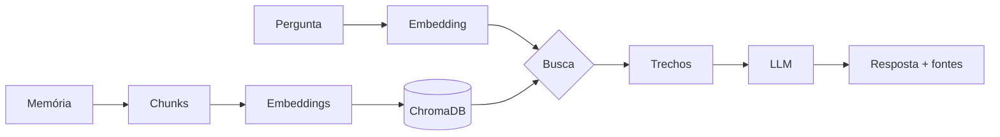

# 🧠 Lembra

**App de organização da vida pessoal com IA.** Você registra memórias, finanças, compromissos e
família, e conversa com um assistente que responde com base no que você mesmo registrou.

Também é um laboratório para dominar IA na prática (RAG, agentes, LLM local, fine-tuning).
Visão completa em [docs/visao-do-produto.md](docs/visao-do-produto.md).

- 📖 **[Guia de conceitos](docs/conceitos.md)**: como tudo funciona, sem precisar ler código
- 🗺️ **[Roadmap](docs/roadmap.md)**: próximas fases

## Como funciona

Dois chats:

1. **✍️ Alimentar:** você escreve memórias e fatos da sua vida. Cada texto é quebrado em
   *chunks*, transformado em *embeddings* (vetores de significado) e guardado num banco vetorial.
2. **💬 Perguntar:** você faz uma pergunta. O sistema busca os trechos mais parecidos e um LLM
   responde **só com base nas suas memórias**, citando as fontes.



## Arquitetura

```
Celular (PWA) ──(crachá JWT)──► API Python (FastAPI) ──(mesmo crachá)──► Supabase
                                 ├─ chunking                              ├─ Login + convites
                                 ├─ embeddings (modelo local)             ├─ Postgres + pgvector
                                 └─ LLM (Claude ou Ollama)                └─ RLS: cada um vê só o seu
```

| Peça | Escolha | Por quê |
|------|---------|---------|
| Banco + login | Supabase (Postgres + pgvector) | Login pronto, busca vetorial e isolamento por usuário (RLS) |
| API | FastAPI | Python, valida os dados e gera página de testes (`/docs`) |
| Embeddings | `sentence-transformers` + `multilingual-e5-small` | Local, grátis, entende português |
| LLM | Claude (API) ou Ollama (local) | Troca pelo `.env` |
| App | PWA (próxima etapa) | Instala no celular sem loja de apps |

## Como rodar a API

```bash
python -m venv .venv
source .venv/bin/activate              # Windows: .venv\Scripts\activate
pip install -e ".[dev]"
cp .env.example .env                   # coloque sua ANTHROPIC_API_KEY
uvicorn lembra.api:app --reload
```

Abra **http://localhost:8000/docs**: é uma página onde dá para testar cada função.
1. `POST /auth/cadastro` com e-mail, senha e **código de convite**
2. Copie o `access_token` da resposta, clique em **Authorize** e cole
3. `POST /memorias` para alimentar, `POST /buscar` para ver só a busca e `POST /perguntar` para o RAG completo

Na primeira execução, o modelo de embeddings (~470 MB) é baixado automaticamente.

## Estrutura

```
src/lembra/
├── chunking.py     # quebra textos em pedaços
├── embeddings.py   # texto → vetor
├── llm.py          # Claude ou Ollama
├── rag.py          # fluxos "alimentar" e "perguntar"
├── supabase.py     # login e dados, sempre com o crachá do usuário
├── api.py          # endpoints que o app chama
└── config.py       # configurações (.env)
supabase/migrations/   # SQL que cria o banco (tabelas, RLS, convites, funções)
tests/                 # testes automáticos (rodam sem internet)
```

## Privacidade

- `.env` está no `.gitignore`: chaves **nunca** vão para o GitHub.
- Cada usuário só acessa os próprios dados, garantido pelo banco (Row Level Security).
- Os embeddings são calculados na própria API, sem serviço externo.
- Com `LLM_PROVIDER=anthropic`, os trechos recuperados em cada pergunta **são enviados** à API
  do Claude. Para manter tudo 100% local, use `LLM_PROVIDER=ollama`.
