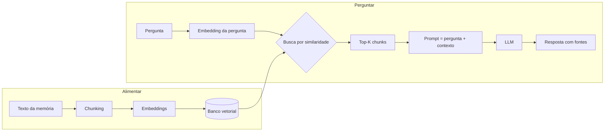

# 🧠 Segundo Cérebro

> Laboratório pessoal para **aprender IA na prática**: começa como um RAG sobre a minha vida
> pessoal e evolui, aula por aula, para LLM local e fine-tuning — com o objetivo final de
> aplicar o aprendizado na empresa.

**Regra do projeto:** nada vem pronto. Cada etapa é uma aula com teoria curta, um exercício e
testes automáticos que funcionam como gabarito. O código é escrito por mim; o Claude explica,
revisa e tira dúvidas.

---

## A ideia

Dois "chats":

1. **Alimentar** — escrevo memórias, fatos e histórias da minha vida. Cada texto é quebrado em
   *chunks*, transformado em *embeddings* (vetores) e guardado num banco vetorial.
2. **Perguntar** — faço uma pergunta; o sistema busca os chunks mais parecidos e entrega para
   um LLM, que responde **só com base nas minhas memórias**, citando as fontes.



Isso é **RAG** (*Retrieval-Augmented Generation*): em vez de treinar o modelo com meus dados,
eu *busco* o que é relevante e *entrego* junto com a pergunta.

## Trilha de aprendizado

| Fase | Tema | Status |
|------|------|--------|
| 0 | Fundação do repositório | ✅ |
| 1 | [Chunking](docs/aulas/01-chunking.md) | 🟡 em andamento |
| 2 | Embeddings | ⬜ |
| 3 | Banco vetorial e busca | ⬜ |
| 4 | Geração com LLM (o "G" do RAG) | ⬜ |
| 5 | Interface com os dois chats | ⬜ |
| 6 | Avaliação e melhorias de RAG | ⬜ |
| 7 | LLM local (Ollama) | ⬜ |
| 8 | Fine-tuning (LoRA) | ⬜ |
| 9 | Levando para a empresa | ⬜ |

Detalhes de cada fase em [`docs/roadmap.md`](docs/roadmap.md).

## Stack

| Peça | Escolha | Por quê |
|------|---------|---------|
| Linguagem | Python 3.10+ | Ecossistema padrão de IA |
| Embeddings | `sentence-transformers` (local) | Grátis, privado, entende português |
| Banco vetorial | ChromaDB | Roda local, zero infraestrutura |
| LLM | Claude (API) → Ollama (local) | Começa com qualidade alta, depois migra para local |
| Interface | Streamlit | UI em Python puro |
| Testes | pytest | Os testes são o gabarito das aulas |

## Como rodar

```bash
python -m venv .venv
source .venv/bin/activate          # Windows: .venv\Scripts\activate
pip install -e ".[dev]"
cp .env.example .env               # e preencha o que for pedido em cada aula

pytest -v                          # mostra quais exercícios já estão resolvidos
```

## Estrutura

```
.
├── docs/
│   ├── roadmap.md            # visão de todas as fases
│   └── aulas/                # uma aula por arquivo (teoria + exercício)
├── src/segundo_cerebro/      # código do projeto (escrito ao longo das aulas)
│   ├── config.py             # configurações lidas do .env
│   └── chunking.py           # Aula 1
├── tests/                    # gabaritos das aulas
├── data/                     # SEUS DADOS — ignorado pelo git
├── .env.example
└── pyproject.toml
```

## Privacidade

Este projeto lida com dados pessoais.

- `data/` e `.env` estão no `.gitignore` — **nunca** suba memórias ou chaves para o GitHub.
- Embeddings e banco vetorial rodam **localmente**.
- Na fase de geração com a API do Claude, os chunks recuperados **são enviados** para a API.
  A Fase 7 (Ollama) existe justamente para ter a opção 100% local.
