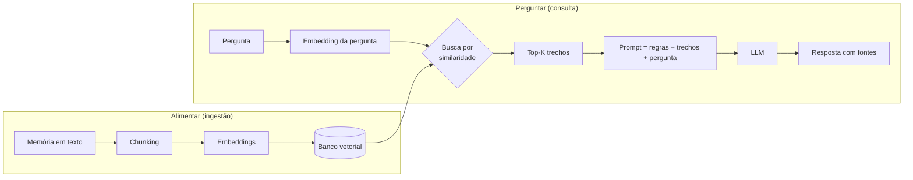

# Guia de conceitos

Explicação, em linguagem simples, de cada peça do projeto e do **porquê** de cada decisão.
Não precisa ler código para entender este documento.

---

## 1. O problema que o RAG resolve

Um LLM (Claude, GPT, Llama…) sabe muita coisa sobre o mundo, mas **nada sobre você** nem
sobre os documentos da sua empresa. Há dois jeitos de dar esse conhecimento a ele:

| Abordagem | Como funciona | Bom para | Ruim para |
|-----------|---------------|----------|-----------|
| **RAG** | A cada pergunta, *busca* os trechos relevantes e *cola* no prompt | Fatos, documentos, coisas que mudam | — |
| **Fine-tuning** | *Re-treina* o modelo com exemplos | Estilo, tom, formato, tarefas repetitivas | Fatos (alucina, desatualiza, caro de refazer) |

Regra prática: **conhecimento → RAG; comportamento → fine-tuning.** Por isso começamos por RAG.

RAG = **R**etrieval (buscar) + **A**ugmented (aumentar o prompt) + **G**eneration (gerar a resposta).

---

## 2. Os dois fluxos



O fluxo **Alimentar** acontece uma vez por memória. O fluxo **Perguntar** acontece a cada pergunta.

---

## 3. Chunking — quebrar o texto em pedaços

**O quê:** dividir textos longos em pedaços de ~800 caracteres.

**Por quê:** cada pedaço vai virar *um* vetor. Se uma memória fala da infância, de uma viagem e
do primeiro emprego, um único vetor seria a "média" dos três assuntos e não combinaria bem com
nenhuma pergunta específica. Pedaços focados resultam numa busca precisa.

**Os dois ajustes:**
- `CHUNK_SIZE`: se for pequeno demais, o pedaço perde contexto ("ela foi adotada em 2020", mas ela quem?). Se for grande demais, a busca fica imprecisa.
- `CHUNK_OVERLAP`: repete o final de um pedaço no começo do próximo, para que uma informação que caiu na "fronteira" não se perca.

**Como cortamos:** de forma *recursiva*, respeitando a estrutura do texto. Primeiro tentamos por
parágrafo; se ainda ficar grande, por linha, depois por frase e por último por palavra. Assim
quase nunca cortamos uma frase no meio.

---

## 4. Embeddings — transformar significado em números

**O quê:** um modelo de IA lê um texto e devolve uma lista de números (um **vetor**; aqui são
384 números). É como uma "coordenada" do significado do texto.

**A mágica:** textos com **sentido** parecido ganham coordenadas próximas, mesmo sem nenhuma
palavra em comum:

```
"minha cachorra Mel"   →  [0.12, -0.40, 0.88, ...]  ┐ perto
"meu animal de estimação" → [0.10, -0.38, 0.85, ...] ┘
"meu salário em 2021"  →  [-0.70, 0.22, 0.05, ...]     longe
```

Uma busca por palavra-chave ("cachorra") não acharia "animal de estimação". A busca por
embedding acha. Isso se chama **busca semântica**.

**Similaridade de cosseno:** é a medida de "quão perto" estão dois vetores, de -1 a 1. Quanto
mais perto de 1, mais parecido. É o número `similaridade` que aparece nas fontes.

**Decisões do projeto:**
- **Modelo `multilingual-e5-small`**: entende português, é pequeno (~470 MB) e roda no seu computador, **grátis e sem enviar seus dados para fora**.
- **Prefixos `query:` / `passage:`**: esse modelo foi treinado sabendo diferenciar "texto guardado" de "pergunta". Marcar cada um melhora a busca.
- **Atenção:** pergunta e documentos **precisam** usar o mesmo modelo. Se você trocar o modelo, as coordenadas mudam e é preciso **reindexar** tudo.

---

## 5. Banco vetorial — guardar e buscar vetores

**O quê:** um banco de dados especializado em responder: *"quais vetores estão mais perto deste?"*

**Por que não um banco normal:** comparar a pergunta com milhões de vetores, um por um, é lento.
Bancos vetoriais usam índices aproximados (como o **HNSW**, um "grafo de vizinhos") que
encontram os mais próximos em milissegundos.

**O que guardamos para cada chunk:**
- o **texto** do chunk;
- o **vetor**;
- os **metadados**: de qual memória veio, categoria e data. Servem para citar a fonte e, no futuro, para filtrar (por exemplo, "só memórias de trabalho").

**Aprendizado do primeiro teste real:** com o modelo E5, o trecho certo teve similaridade
~0,87 e os errados ~0,82. Este modelo dá notas altas para tudo, então **a ordem importa mais que o
número**. Consequências: (1) um corte fixo do tipo "só acima de 0,8" não funciona; (2) trechos
irrelevantes também chegam ao LLM, e por isso o prompt manda ignorar o que não responde à
pergunta. Soluções futuras: re-ranking e filtro por categoria.

**Top-K:** quantos trechos trazemos por pergunta (`TOP_K=5`). Se forem poucos, a resposta pode
faltar. Se forem muitos, entra ruído e o custo do prompt aumenta.

**Decisão: fonte da verdade separada do índice**
- Tabela `memorias`: o texto original de tudo que a pessoa escreveu.
- Tabela `chunks`: os pedaços e vetores, **derivados** da tabela acima.

Se mudarmos o modelo de embeddings ou o tamanho do chunk, basta apagar os chunks e recalculá-los
a partir das memórias, sem perder nada. Na empresa é igual: o documento original é a verdade, e o
índice é descartável.

**Histórico:** o protótipo usava **ChromaDB** (banco vetorial local, sem servidor). Com vários
usuários, migramos para **pgvector** no Supabase: o mesmo Postgres guarda texto, vetores e login,
e aplica o isolamento por usuário. Outras opções de mercado: Qdrant, Weaviate, Pinecone.

---

## 6. Geração — o LLM escreve a resposta

Com os trechos em mãos, montamos um prompt em três partes:

1. **Instruções (system prompt):** "responda APENAS com base nas memórias; cite [1], [2]; se não souber, diga que não sabe."
2. **Contexto:** os trechos recuperados, numerados, com categoria e data.
3. **Pergunta** do usuário.

**Por que tanta regra?** Para combater a **alucinação**: sem instrução, o modelo poderia
"completar" com algo plausível porém falso sobre a sua vida. Exigir citações também deixa você
**conferir** de onde veio cada afirmação.

**Provedores atrás da mesma interface** (troca pelo `LLM_PROVIDER` no `.env`):
- **Gemini (API do Google):** tem **nível gratuito** (chave em aistudio.google.com). O preço do grátis: o Google pode usar os trechos e perguntas enviados para melhorar produtos, e pessoas podem lê-los. No pago, não.
- **Claude (API da Anthropic):** pago por uso, não incluso no plano Pro (que cobre só o app e o site). Não usa os dados para treino.
- **Ollama (local):** grátis e 100% privado, mas o computador precisa ficar ligado e ter memória suficiente.
- **Nenhum:** sem IA generativa; o app mostra as memórias encontradas.

**Assinatura × API:** Claude Pro, Gemini Pro e ChatGPT são planos para *pessoas* usarem os apps.
Para um *programa* chamar o modelo, usa-se a API, com cobrança e regras próprias.

**Degradação graciosa:** se o LLM falhar (limite diário, rede, chave inválida), o app não quebra:
mostra as memórias encontradas com um aviso. Um sistema bom continua útil quando uma peça cai.

**Sem IA, filtro "perto do melhor":** como o E5 dá notas parecidas para tudo, no modo sem IA o app
mostra só os trechos com nota até 0,03 abaixo da melhor. É uma **heurística** (regra prática
baseada nos testes), não uma garantia. Com IA isso não é preciso, porque o LLM ignora o irrelevante.

**`effort`:** no Claude, define quanto o modelo "pensa" antes de responder. `low` responde mais
rápido e gasta menos; `high` raciocina mais.

---

## 7. Multiusuário e segurança (Supabase)

Quando várias pessoas usam o mesmo app, o maior risco é **um usuário ver os dados de outro**.

**Onde os dados ficam:** no Supabase, que é um Postgres na nuvem com login pronto. A extensão
**pgvector** ensina o Postgres a guardar vetores e buscar os mais próximos, substituindo o
ChromaDB. As tabelas são `memorias` (texto original, a fonte da verdade) e `chunks` (pedaços e
vetores, o índice).

**Row Level Security (RLS):** cada linha tem um dono (`user_id`). O banco aplica, **em toda
consulta**, a regra "só devolva linhas onde o dono é quem está logado". Por que no banco e não
só no código? Porque código tem bug. Se um dia o app pedir "todas as memórias" por engano, o
banco devolve só as do usuário logado. É a última linha de defesa.

Testado com dois usuários simulados (Ana e Beto):

| Teste | Resultado |
|-------|-----------|
| Beto lista memórias | vê só a dele |
| Beto faz busca vetorial | não encontra nada da Ana |
| Beto tenta apagar a memória da Ana | 0 linhas apagadas |
| Ana busca filtrando por "família" | nada (a memória dela é de "finanças") |

**Como o login conversa com o banco:** ao entrar, o usuário recebe um **token** (JWT), uma
espécie de crachá assinado que diz "eu sou o usuário X". Toda chamada ao banco leva esse
crachá, e o RLS lê quem é o dono a partir dele. Por isso a API **nunca** deve usar a chave
administrativa (`service_role`), que ignora o RLS: ela sempre repassa o crachá do usuário.

**Login (Supabase Auth):**
- A senha nunca é guardada como foi digitada, só um *hash* (bcrypt), uma "impressão digital" que não dá para reverter.
- Ao entrar, a pessoa recebe um **access token (JWT)**, que dura ~1 hora e vai em toda chamada, e um **refresh token**, que renova o JWT sem pedir a senha de novo e mantém o app logado.
- **Confirmação de e-mail desligada** (igual ao projeto Finanças BM): o cadastro é instantâneo e nenhum e-mail é enviado. Motivo: o e-mail embutido do Supabase gratuito só chega a membros da organização. Preço: não se verifica se o e-mail é mesmo da pessoa. Por isso, o cadastro vai exigir **código de convite**, validado **no banco** (não só na tela, que pode ser contornada chamando a API direto).
- "Esqueci minha senha" depende de e-mail, então fica para quando houver um serviço de e-mail próprio (ex.: Resend).

**Teste real pela internet** (duas contas de verdade, mesmo caminho que o app usará):

| Tentativa | Resultado |
|-----------|-----------|
| Beto lê memórias | lista vazia (a da Ana é invisível) |
| Beto apaga a memória da Ana | 0 linhas apagadas |
| Beto cria memória em nome da Ana | bloqueado: HTTP 403, *violates row-level security policy* |
| Sem login, lê memórias | lista vazia |
| Conta da Ana excluída | a memória dela foi apagada junto (*cascade*) |

**Convites (cadastro fechado) — DESLIGADO:** a pedido do dono, o cadastro passou a ser livre (cada testador cria a própria conta). O trigger foi removido, mas tabelas e funções continuam no banco para religar se preciso. Os dados seguem isolados pelo RLS; o risco aberto é estranhos gastarem a cota grátis do Gemini. Como funcionava:
- Tabela `convites`: código aleatório de uso único, validade (14 dias), e-mail opcional.
- **Trigger** = regra que o banco executa sozinho a cada evento. Aqui ele roda a cada conta nova e **cancela o cadastro** se o código for inválido, vencido, já usado ou de outro e-mail. Como está no banco, vale para o app, para a API direta e até para o botão "Add user" do painel: o convite é a **única porta de entrada**.
- `FOR UPDATE` trava o convite durante o cadastro, para que duas pessoas não usem o mesmo código ao mesmo tempo (*condição de corrida*).
- Só **admins** geram convites, pela função `criar_convite`. O primeiro admin nasce de um convite especial (`torna_admin`), resolvendo o "ovo e a galinha".
- **`SECURITY DEFINER`**: a função roda com os poderes de quem a criou, passando por cima do RLS. O verificador do Supabase alerta sobre isso. Aqui é intencional: é a única porta para criar convites, e ela checa se quem chama é admin. Lição: **avisos de ferramentas apontam riscos, não erros**, e cada um precisa de análise.

Testado pela internet: sem código, código inventado, vencido, de outro e-mail e reutilizado foram **barrados**; usuário comum não consegue gerar convite, inserir convite direto nem se promover a admin.

**A API (FastAPI):** é o "garçom" entre o app e o banco. O app manda o pedido junto com o
crachá; a API faz o trabalho de IA (chunking, embeddings, chamada ao LLM) e repassa o **mesmo
crachá** ao Supabase. A API nunca decide sozinha o que a pessoa pode ver: quem decide é o banco.

**Transação ("tudo ou nada"):** salvar uma memória são dois passos (memória + chunks). A função
`salvar_memoria` faz os dois dentro de uma transação. Se o segundo falhar, o primeiro é desfeito,
e nunca sobra uma memória "órfã" que não aparece na busca.

**Teste real ponta a ponta** (API + modelo real + Supabase): "pet" encontrou a cachorra, "gasto
de moradia" encontrou o aluguel e "médico agendado" encontrou o dentista. O Beto não viu nem
apagou nada da Ana. Filtrar "médico agendado" só em `finanças` trouxe o aluguel: o filtro restringe
os candidatos, mas não garante relevância. É o LLM que precisa dizer "não encontrei".

**Filtro por categoria:** a função `buscar_chunks` aceita uma categoria opcional. "Quanto gastei…"
pode buscar só em `finanças`: menos candidatos, menos ruído.

**LGPD:** apagar uma memória apaga os chunks dela; excluir a conta apaga tudo da pessoa
(*on delete cascade*).

**Migrations:** o SQL que criou tudo isso fica salvo em `supabase/migrations/`. É a "receita"
versionada para recriar o banco em qualquer lugar.

---

## 8. O app (PWA)

**PWA (*Progressive Web App*):** um site que se comporta como app. Duas peças fazem isso:
- **Manifest** (`web/manifest.webmanifest`): nome, ícones e cores. Faz o celular oferecer
  "Adicionar à tela inicial" e abrir em tela cheia, sem barra do navegador.
- **Service worker** (`web/sw.js`): programa que o navegador guarda e que serve a "casca" do app
  (telas, estilos, ícones) do próprio celular, por isso abre rápido. **Decisão de privacidade:**
  ele nunca guarda memórias nem respostas, só a casca.

**XSS (*Cross-Site Scripting*):** ataque em que alguém escreve código dentro de um texto (ex.: uma
memória) e esse código "executa" na tela de quem vê. Defesa: todo texto vindo do usuário é exibido
como texto puro (`textContent`), nunca como HTML. Testado: uma memória com código malicioso apareceu
como texto e não executou.

**Sessão no celular:** o app guarda o crachá e, quando ele vence (~1 hora), usa o *refresh token*
para pegar outro sem pedir senha. Ao sair, a tela é limpa: quem entrar depois não vê nada.

**Design system (redesenho v1):** cores, raios, sombras e velocidades de animação são
**variáveis** no topo do `styles.css` (*design tokens*): mudar o tema é trocar poucos valores.
Técnicas usadas: vidro fosco (`backdrop-filter: blur`), fundo "aurora" animado só com CSS,
ícones do Lucide embutidos (funcionam offline), efeitos de hover só em aparelhos com mouse
(`@media (hover: hover)`) e respeito a quem pede "reduzir movimento" no sistema
(`prefers-reduced-motion`).

**Revisão visual v2:**
- O `<select>` nativo foi trocado por um **menu próprio**: a lista do `select` é desenhada pelo
  sistema operacional e o CSS não a alcança. O `select` continua existindo, escondido, guardando
  o valor (aparência nova, comportamento antigo), e um `MutationObserver` redesenha o menu
  quando as opções mudam.
- Vidro fosco (`backdrop-filter`) **não funciona dentro de outro vidro fosco**: a lista do menu
  usa fundo sólido.
- As respostas da IA vêm em marcação (negrito, listas, [1]). São formatadas montando os
  elementos um a um com `textContent`, nunca `innerHTML`, o que mantém a proteção contra XSS.

**Sugestão de categoria (classificação "zero-shot"):** ao parar de digitar por 1,5 s (*debounce*),
a IA escolhe entre as categorias **que a pessoa criou**, ou propõe uma nova. Usa **saída estruturada**:
o Gemini é obrigado a responder no esquema `{categoria, e_nova, motivo}`. Mesmo assim o código
confere (se a IA disser "existente" com um nome fora da lista, vira "nova"). Alternativa
considerada: comparar o embedding da memória com a média dos embeddings de cada categoria. É mais
barato, mas só funciona com muitas memórias já categorizadas e não propõe categorias novas.
Teste real: conta de luz → finanças; cardiologista → saúde; aula de violão → "hobbies" (nova).

**Categorias:** cada pessoa cria as próprias; nada vem pré-definido. Sem categoria escolhida, a
memória vai para "geral" (criada só nesse caso).

**CORS:** por segurança, o navegador só deixa um site chamar uma API de **outro endereço** se a API
autorizar esse endereço. Quando o app for para a Vercel e a API ficar em outro lugar, o endereço do
app entra em `ALLOWED_ORIGINS`.

---

## 9. Configurar o RAG pelo app (Ajustes)

Cada pessoa tem a **sua** configuração (tabela `config_rag`, com RLS). Sem configuração salva,
valem os padrões do servidor. Os limites (ex.: chunk entre 200 e 3.000) ficam **no banco**.

| Ajuste | O que muda | Trade-off |
|--------|------------|-----------|
| Tamanho do chunk | Em quantos caracteres a memória é quebrada | Menor = busca precisa, pouco contexto; maior = o contrário |
| Sobreposição | Quanto se repete entre pedaços vizinhos | Só age quando o texto quebra em partes menores que ela |
| Top-K | Quantos trechos vão para a IA | Poucos = pode faltar; muitos = ruído e lentidão |
| Margem de relevância | No modo sem IA, quão longe da melhor nota ainda aparece | Pequena = só o melhor; grande = mais ruído |
| Usar IA | Gerar resposta ou só mostrar memórias | Sem IA: grátis e nada vai para o Google |
| Modelo | Flash-Lite (rápido, mais cota) ou Flash (mais elaborado) | Qualidade × cota grátis |
| Instruções | Preferências de formato ("responda em tópicos") | Entram **depois** das regras e não podem anulá-las |

**Teste real (chunk 800 × 250)** numa memória de viagem com 3 parágrafos: com 800 virou 1 chunk
misturando Chile, Atacama e Santiago; com 250 virou 3 chunks, e a pergunta "quanto gastei?"
achou o trecho exato do gasto (0,79) bem à frente dos outros (0,67). Chunks menores, busca mais precisa.

**Reprocessar:** mudar o tamanho do chunk não altera as memórias antigas. O botão "Reprocessar"
refaz pedaços e vetores a partir do texto original (fonte da verdade), num único lote de
embeddings para gastar menos chamadas à API.

**Laboratório:** "testar chunking" mostra como um texto seria quebrado, sem salvar; cada
memória mostra os próprios chunks; cada fonte de resposta mostra a nota de similaridade.

**Editar memória:** se só a categoria ou a data mudam, os vetores são mantidos (economia de cota);
se o texto muda, chunks e vetores são refeitos numa transação.

---

## 10. Avaliação com "LLM como juiz" (`avaliacao/`)

**Por que avaliar:** testar "no olho" com 3 ou 4 perguntas não diz se uma mudança melhorou o
sistema **no geral**. Um **conjunto de avaliação** (perguntas fixas com respostas conhecidas)
rodado a cada mudança dá números comparáveis.

**O conjunto** (`avaliacao/conjunto.json`): 10 memórias fictícias e 14 perguntas de tipos
diferentes (fato, paráfrase, conta, juntar duas memórias, detalhe em texto longo e perguntas
**sem resposta**, para ver se o sistema inventa).

**Duas famílias de métricas:**
- **Busca** (por conta, sem IA): **recall@K** (das memórias certas, quantas vieram), **acerto@1**
  (a 1ª veio certa?), **MRR** (média de 1/posição da primeira certa).
- **Resposta** (decidida por um LLM juiz): **correta** (traz a informação esperada?) e **fiel**
  (tudo o que afirma está nas memórias entregues?). Separadas porque apontam para lugares
  diferentes: *correta mas infiel* = a IA chutou; *fiel mas incorreta* = a busca não trouxe o trecho.

**Decisões:**
- Roda num banco em memória (mesmo chunking, embeddings e LLM do app): repetível e não suja o Supabase.
- Juiz binário (passou/não passou) com justificativa: LLMs são inconsistentes com notas de 1 a 5.
- **Limitação:** Gemini julgando Gemini (viés de autopreferência). Em produção: juiz de outra
  família e conferência humana de uma amostra.

**O que aprendemos rodando:**
1. **Efeito teto:** com 10 memórias e top-K=5, tudo deu 100%. Teste fácil demais não distingue
   configurações. Apertando para top-K=1, a pergunta que precisa de duas memórias quebrou.
2. **Testar o juiz:** `avaliacao/testar_juiz.py` entrega respostas plantadas (certas e erradas).
   Um juiz que aprova tudo não serve.
3. **O juiz errou mesmo assim:** num caso real, leu errado se a pergunta tinha resposta. Correção:
   **o que o código sabe, o código decide** (o tipo da pergunta agora é informado explicitamente),
   e o caso virou teste do juiz. Sempre confira uma amostra à mão.
4. **Ruído:** a mesma pergunta passou numa rodada e falhou na outra. Diferença de 1 em 14 pode
   ser acaso. Avaliação séria usa conjuntos maiores e várias repetições.
5. **Problema real encontrado:** "tenho médico marcado?" → o Lembra achou o dentista, mas abriu
   a resposta com "não encontrei menção a médicos" (literal demais). Candidato a ajuste de prompt.

6. **Antes × depois do prompt "interpretar pelo sentido"** (3 repetições cada): empate em 100% em
   todas as métricas. A falha do "médico" é rara demais para aparecer em 3 tentativas (efeito teto).
   Decisão: adotar o v2, porque **não piorou nada** (inclusive admitir quando não sabe), trata uma
   falha real e alinha com o modo agente. Registro honesto: a prova foi de "não piorou", não de
   "melhorou". Para medir melhorias pequenas: conjunto mais difícil.

**Como usar:** `python avaliacao/avaliar.py --rotulo nome [--chunk-size N --top-k K]`, depois
`python avaliacao/comparar.py`. Mudança só vale se melhorar sem piorar outra métrica.

---

## 11. Importar conversas do WhatsApp

**Por que exportar:** a API oficial do WhatsApp não lê conversas pessoais. Exportar (conversa →
⋮ → Mais → Exportar conversa → Sem mídia) é o caminho oficial, e o usuário escolhe quais conversas entram.

**Leitura do arquivo (`src/lembra/whatsapp.py`):** Android e iPhone exportam em formatos
diferentes (`03/11/2026 14:05 - João: oi` × `[03/11/2026, 14:05:22] João: oi`). Mensagens com
várias linhas continuam sem cabeçalho e são juntadas. Ruído (aviso de criptografia, "mídia
oculta", mensagem apagada) é descartado.

**Chunking de conversa ≠ chunking de texto:** conversa não tem parágrafos; tem mensagens
curtas, autores e horários. A estratégia:
- quebrar por **sessão**: mais de 6 horas sem mensagem começa um bloco novo (assuntos mudam com o tempo);
- blocos grandes são divididos **entre mensagens**, nunca no meio de uma;
- cada bloco vira uma **memória**, com a data como metadado e um cabeçalho de contexto
  ("Conversa de WhatsApp "João" em 04/11/2026, entre Bruno, João Silva") que ajuda a busca.

**Prévia antes de salvar:** mostra mensagens, blocos, período e participantes **sem chamar
nenhuma IA**. Limite de 200 blocos por importação (protege a cota e o tempo da requisição);
os embeddings saem em lotes de 100.

**LGPD:** a conversa tem mensagens de outras pessoas. O app avisa para importar só o que o
usuário tem o direito de guardar.

---

## 12. Agentes (modo agente, experimental)

Um **agente** é um LLM que recebe **ferramentas** (funções do nosso código) e decide sozinho quais
chamar, em que ordem, olhando os resultados antes de responder. O LLM só **pede**: quem executa e
controla é o código (`src/lembra/agente.py`).

```
Pergunta: "Quanto gasto por mês somando moradia e academia?"
  passo 1: buscar_memorias("moradia aluguel")   -> 3 trechos
  passo 2: buscar_memorias("academia")          -> 3 trechos
  passo 3: calcular("1800 + 450 + 120")         -> 2370
  resposta: "R$ 2.370 por mês [1] [2]"
```

**Ferramentas:** `buscar_memorias` (o RAG virou uma ferramenta, e o agente pode buscar várias vezes),
`listar_memorias` (filtro exato), `listar_categorias`, `calcular`, `data_de_hoje`, `dias_ate`.

**Decisões:**
- **Ciclo manual** (sem o modo automático da biblioteca), para ficar visível e controlável.
- **Limite de 5 passos:** sem limite, um agente pode entrar em ciclo e gastar cota.
- **Calculadora segura:** nunca `eval()`, que executaria qualquer código. Só números e `+ - * / ( )`.
  Testada contra tentativas de injetar código.
- **Erro de ferramenta vira informação** para o LLM, e não derruba o app. Se o agente inteiro
  falhar, o RAG normal assume (degradação graciosa).
- **"Como cheguei aqui":** cada resposta mostra as ferramentas usadas.
- Desligado por padrão: mais lento e gasta várias chamadas por pergunta.

**Lição do teste real:** o agente errou "quantos dias faltam para 21/08" (disse 352; o certo é
291) porque montou a conta somando meses de cabeça, e errou os meses. A calculadora somou certo
uma conta montada errada. **Ferramenta não corrige raciocínio errado: dê a ferramenta certa para
a tarefa.** Com `dias_ate` (datas calculadas em código), passou a acertar.

## Desempenho: medir antes de otimizar

Medição de uma pergunta comum: o Gemini respondia em ~1 s (sem "pensar"); o lento eram duas
consultas ao banco de ~0,75 s cada. Causas e correções:
1. **Uma conexão nova por consulta** refazia o "aperto de mão" de criptografia (TLS). Agora uma
   **sessão HTTP reaproveitada** (*keep-alive*): 0,72 s para 0,23 s.
2. **Distância:** a função da Vercel rodava nos EUA e o banco está em São Paulo. Agora a região
   é **São Paulo (`gru1`)**, em `vercel.json`.
3. **Paralelismo:** a configuração do usuário e o embedding da pergunta são buscados **ao mesmo
   tempo**, porque um não depende do outro.

O modo agente é naturalmente mais lento: são várias idas ao LLM por pergunta.

## 13. Fine-tuning "só a ponta" (próximas fases)

Um modelo de linguagem é feito de camadas. As primeiras aprendem coisas gerais (gramática,
significado das palavras) e as últimas, coisas específicas da tarefa.

- **Treinar tudo:** caro, exige muita GPU e pode fazer o modelo "esquecer" o que sabia.
- **Congelar o corpo e treinar a ponta:** mantém o conhecimento geral e ajusta só o final. É rápido e barato.
- **LoRA:** em vez de mexer nos pesos originais, acopla pequenas matrizes extras e treina só elas. Fica com menos de 1% dos parâmetros e resultado próximo ao do treino completo. O arquivo final é pequeno (MBs) e pode ser ligado ou desligado no modelo base.
- **QLoRA:** LoRA com o modelo base comprimido em 4 bits, o que cabe numa GPU grátis.

## 14. Glossário rápido

| Termo | Significado |
|-------|-------------|
| **LLM** | *Large Language Model*: o modelo que gera texto |
| **Token** | Pedaço de palavra; é a unidade de custo e de limite dos LLMs |
| **Janela de contexto** | Quanto texto o LLM consegue "ler" de uma vez |
| **Chunk** | Pedaço de um documento |
| **Embedding / vetor** | Lista de números que representa o significado de um texto |
| **Busca semântica** | Busca por significado, não por palavra exata |
| **Top-K** | Os K resultados mais parecidos |
| **Alucinação** | Quando o modelo inventa algo com confiança |
| **Grounding** | "Ancorar" a resposta em fontes fornecidas |
| **Re-ranking** | Segundo passo que reordena os resultados da busca com um modelo mais preciso |
| **Busca híbrida** | Combina busca por palavra-chave (BM25) com busca vetorial |
| **Quantização** | Comprimir um modelo (ex.: 16 bits → 4 bits) para rodar em hardware mais modesto |
| **Fine-tuning / LoRA** | Re-treinar um modelo; LoRA ajusta só uma pequena parte dele, de forma barata |
| **Agente** | LLM que escolhe e chama ferramentas em ciclo até resolver a tarefa |
| **Tool / ferramenta** | Função do seu código que o LLM pode pedir para executar |
| **Congelar camadas** | Impedir que parte do modelo mude durante o treino |
| **RLS** | *Row Level Security*: o banco filtra as linhas por usuário em toda consulta |
| **JWT** | "Crachá" digital assinado que prova quem é o usuário logado |
| **Migration** | Arquivo com as mudanças de estrutura do banco, versionado no Git |
| **Trigger** | Regra que o banco executa automaticamente quando algo acontece (ex.: nova conta) |
| **SECURITY DEFINER** | Função que roda com os poderes de quem a criou, e não de quem a chama |
| **Condição de corrida** | Bug em que duas operações simultâneas interferem uma na outra |
| **PWA** | Site instalável que se comporta como app |
| **Service worker** | Programa do navegador que guarda a "casca" do app para abrir rápido |
| **XSS** | Ataque em que código escondido num texto executa na tela de outra pessoa |
| **CORS** | Regra do navegador que controla quais sites podem chamar uma API |
| **Heurística** | Regra prática que funciona na maioria dos casos, sem garantia |
| **Conjunto de avaliação** | Perguntas fixas com respostas conhecidas, rodadas a cada mudança |
| **LLM como juiz** | Um modelo que avalia as respostas de outro segundo critérios claros |
| **Recall@K / MRR** | Métricas de busca: quantas certas vieram / em que posição veio a primeira certa |
| **Efeito teto** | Teste fácil demais: tudo passa e nada se compara |
| **PEFT** | *Parameter-Efficient Fine-Tuning*: família de técnicas (LoRA etc.) que treinam poucos parâmetros |
