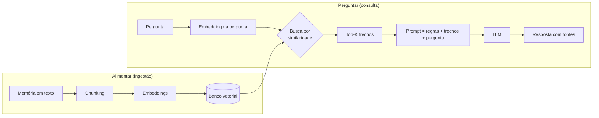

# Guia de conceitos

Explicação, em linguagem simples, de cada peça do projeto e do **porquê** de cada decisão.
Não precisa ler código para entender este documento.

---

## 1. O problema que o RAG resolve

Um LLM (Claude, GPT, Llama…) sabe muita coisa sobre o mundo, mas **nada sobre você** nem
sobre os documentos da sua empresa. Há dois jeitos de dar esse conhecimento a ele:

| Abordagem | Como funciona | Bom para | Ruim para |
|-----------|---------------|----------|-----------|
| **RAG** | A cada pergunta, *busca* os trechos relevantes e *cola* no prompt | Fatos, documentos, coisas que mudam | — |
| **Fine-tuning** | *Re-treina* o modelo com exemplos | Estilo, tom, formato, tarefas repetitivas | Fatos (alucina, desatualiza, caro de refazer) |

Regra prática: **conhecimento → RAG; comportamento → fine-tuning.** Por isso começamos por RAG.

RAG = **R**etrieval (buscar) + **A**ugmented (aumentar o prompt) + **G**eneration (gerar a resposta).

---

## 2. Os dois fluxos



O fluxo **Alimentar** acontece uma vez por memória. O fluxo **Perguntar** acontece a cada pergunta.

---

## 3. Chunking — quebrar o texto em pedaços

**O quê:** dividir textos longos em pedaços de ~800 caracteres.

**Por quê:** cada pedaço vai virar *um* vetor. Se uma memória fala da infância, de uma viagem e
do primeiro emprego, um único vetor seria a "média" dos três assuntos e não combinaria bem com
nenhuma pergunta específica. Pedaços focados resultam numa busca precisa.

**Os dois ajustes:**
- `CHUNK_SIZE`: se for pequeno demais, o pedaço perde contexto ("ela foi adotada em 2020", mas ela quem?). Se for grande demais, a busca fica imprecisa.
- `CHUNK_OVERLAP`: repete o final de um pedaço no começo do próximo, para que uma informação que caiu na "fronteira" não se perca.

**Como cortamos:** de forma *recursiva*, respeitando a estrutura do texto. Primeiro tentamos por
parágrafo; se ainda ficar grande, por linha, depois por frase e por último por palavra. Assim
quase nunca cortamos uma frase no meio.

---

## 4. Embeddings — transformar significado em números

**O quê:** um modelo de IA lê um texto e devolve uma lista de números (um **vetor**; aqui são
384 números). É como uma "coordenada" do significado do texto.

**A mágica:** textos com **sentido** parecido ganham coordenadas próximas, mesmo sem nenhuma
palavra em comum:

```
"minha cachorra Mel"   →  [0.12, -0.40, 0.88, ...]  ┐ perto
"meu animal de estimação" → [0.10, -0.38, 0.85, ...] ┘
"meu salário em 2021"  →  [-0.70, 0.22, 0.05, ...]     longe
```

Uma busca por palavra-chave ("cachorra") não acharia "animal de estimação". A busca por
embedding acha. Isso se chama **busca semântica**.

**Similaridade de cosseno:** é a medida de "quão perto" estão dois vetores, de -1 a 1. Quanto
mais perto de 1, mais parecido. É o número `similaridade` que aparece nas fontes.

**Decisões do projeto:**
- **Modelo `multilingual-e5-small`**: entende português, é pequeno (~470 MB) e roda no seu computador, **grátis e sem enviar seus dados para fora**.
- **Prefixos `query:` / `passage:`**: esse modelo foi treinado sabendo diferenciar "texto guardado" de "pergunta". Marcar cada um melhora a busca.
- **Atenção:** pergunta e documentos **precisam** usar o mesmo modelo. Se você trocar o modelo, as coordenadas mudam e é preciso **reindexar** tudo.

---

## 5. Banco vetorial — guardar e buscar vetores

**O quê:** um banco de dados especializado em responder: *"quais vetores estão mais perto deste?"*

**Por que não um banco normal:** comparar a pergunta com milhões de vetores, um por um, é lento.
Bancos vetoriais usam índices aproximados (como o **HNSW**, um "grafo de vizinhos") que
encontram os mais próximos em milissegundos.

**O que guardamos para cada chunk:**
- o **texto** do chunk;
- o **vetor**;
- os **metadados**: de qual memória veio, categoria e data. Servem para citar a fonte e, no futuro, para filtrar (por exemplo, "só memórias de trabalho").

**Aprendizado do primeiro teste real:** com o modelo E5, o trecho certo teve similaridade
~0,87 e os errados ~0,82. Este modelo dá notas altas para tudo, então **a ordem importa mais que o
número**. Consequências: (1) um corte fixo do tipo "só acima de 0,8" não funciona; (2) trechos
irrelevantes também chegam ao LLM, e por isso o prompt manda ignorar o que não responde à
pergunta. Soluções futuras: re-ranking e filtro por categoria.

**Top-K:** quantos trechos trazemos por pergunta (`TOP_K=5`). Se forem poucos, a resposta pode
faltar. Se forem muitos, entra ruído e o custo do prompt aumenta.

**Decisão: fonte da verdade separada do índice**
- `data/memorias.jsonl` é o texto original de tudo que você escreveu, legível e fácil de copiar para backup.
- `data/chroma/` é o índice, **derivado** do arquivo acima.

Se você mudar o modelo de embeddings ou o tamanho do chunk, apaga o índice e reconstrói
(`lembra reindexar`) sem perder nada. Na empresa é igual: o documento original é a verdade, e o
índice é descartável.

Usamos **ChromaDB** porque roda local, sem servidor. Em produção, a mesma ideia roda em
**pgvector** (extensão do Postgres), Qdrant, Weaviate, Pinecone etc.

---

## 6. Geração — o LLM escreve a resposta

Com os trechos em mãos, montamos um prompt em três partes:

1. **Instruções (system prompt):** "responda APENAS com base nas memórias; cite [1], [2]; se não souber, diga que não sabe."
2. **Contexto:** os trechos recuperados, numerados, com categoria e data.
3. **Pergunta** do usuário.

**Por que tanta regra?** Para combater a **alucinação**: sem instrução, o modelo poderia
"completar" com algo plausível porém falso sobre a sua vida. Exigir citações também deixa você
**conferir** de onde veio cada afirmação.

**Dois provedores atrás da mesma interface:**
- **Claude (API):** respostas de alta qualidade. Os trechos recuperados **são enviados** à Anthropic.
- **Ollama (local):** o modelo roda na sua máquina, então nada sai dela. A qualidade depende do modelo e do seu hardware.

Trocar entre eles é só mudar `LLM_PROVIDER` no `.env`. Esse "plugável" é o que permite começar na
nuvem e migrar para local depois.

**`effort`:** no Claude, define quanto o modelo "pensa" antes de responder. `low` responde mais
rápido e gasta menos; `high` raciocina mais.

---

## 7. Multiusuário e segurança (Supabase)

Quando várias pessoas usam o mesmo app, o maior risco é **um usuário ver os dados de outro**.

**Onde os dados ficam:** no Supabase, que é um Postgres na nuvem com login pronto. A extensão
**pgvector** ensina o Postgres a guardar vetores e buscar os mais próximos, substituindo o
ChromaDB. As tabelas são `memorias` (texto original, a fonte da verdade) e `chunks` (pedaços e
vetores, o índice).

**Row Level Security (RLS):** cada linha tem um dono (`user_id`). O banco aplica, **em toda
consulta**, a regra "só devolva linhas onde o dono é quem está logado". Por que no banco e não
só no código? Porque código tem bug. Se um dia o app pedir "todas as memórias" por engano, o
banco devolve só as do usuário logado. É a última linha de defesa.

Testado com dois usuários simulados (Ana e Beto):

| Teste | Resultado |
|-------|-----------|
| Beto lista memórias | vê só a dele |
| Beto faz busca vetorial | não encontra nada da Ana |
| Beto tenta apagar a memória da Ana | 0 linhas apagadas |
| Ana busca filtrando por "família" | nada (a memória dela é de "finanças") |

**Como o login conversa com o banco:** ao entrar, o usuário recebe um **token** (JWT), uma
espécie de crachá assinado que diz "eu sou o usuário X". Toda chamada ao banco leva esse
crachá, e o RLS lê quem é o dono a partir dele. Por isso a API **nunca** deve usar a chave
administrativa (`service_role`), que ignora o RLS: ela sempre repassa o crachá do usuário.

**Login (Supabase Auth):**
- A senha nunca é guardada como foi digitada, só um *hash* (bcrypt), uma "impressão digital" que não dá para reverter.
- Ao entrar, a pessoa recebe um **access token (JWT)**, que dura ~1 hora e vai em toda chamada, e um **refresh token**, que renova o JWT sem pedir a senha de novo e mantém o app logado.
- **Fase de testes:** o cadastro público fica **desligado**, e o dono cria as contas dos testadores no painel, já confirmadas. Motivo: o e-mail embutido do Supabase gratuito só envia para membros da organização, então testadores não receberiam o e-mail de confirmação. Para abrir ao público, será preciso um serviço de e-mail próprio (ex.: Resend).

**Filtro por categoria:** a função `buscar_chunks` aceita uma categoria opcional. "Quanto gastei…"
pode buscar só em `finanças`: menos candidatos, menos ruído.

**LGPD:** apagar uma memória apaga os chunks dela; excluir a conta apaga tudo da pessoa
(*on delete cascade*).

**Migrations:** o SQL que criou tudo isso fica salvo em `supabase/migrations/`. É a "receita"
versionada para recriar o banco em qualquer lugar.

---

## 8. Agentes (próximas fases)

Um **agente** é um LLM que, em vez de seguir um roteiro fixo, recebe uma lista de
**ferramentas** (funções que o seu código executa) e decide sozinho quais chamar.

```
Pergunta: "Quanto gastei com mercado em outubro?"

Fluxo fixo (hoje):  buscar 5 trechos parecidos → responder
                    (pode errar a conta: os gastos estão espalhados em vários trechos)

Agente:             LLM pensa → chama somar_gastos(categoria="mercado", mes="2026-10")
                    → recebe 842,30 → responde "R$ 842,30, em 12 compras"
```

O ciclo é: o LLM pede uma ferramenta, o código executa, o resultado volta para o LLM, e isso se
repete até ele ter a resposta. **Custo:** mais chamadas ao LLM, o que significa mais lento e mais
caro. Só vale a pena quando a pergunta realmente precisa de decisões ou de cálculos.

## 9. Fine-tuning "só a ponta" (próximas fases)

Um modelo de linguagem é feito de camadas. As primeiras aprendem coisas gerais (gramática,
significado das palavras) e as últimas, coisas específicas da tarefa.

- **Treinar tudo:** caro, exige muita GPU e pode fazer o modelo "esquecer" o que sabia.
- **Congelar o corpo e treinar a ponta:** mantém o conhecimento geral e ajusta só o final. É rápido e barato.
- **LoRA:** em vez de mexer nos pesos originais, acopla pequenas matrizes extras e treina só elas. Fica com menos de 1% dos parâmetros e resultado próximo ao do treino completo. O arquivo final é pequeno (MBs) e pode ser ligado ou desligado no modelo base.
- **QLoRA:** LoRA com o modelo base comprimido em 4 bits, o que cabe numa GPU grátis.

## 10. Glossário rápido

| Termo | Significado |
|-------|-------------|
| **LLM** | *Large Language Model*: o modelo que gera texto |
| **Token** | Pedaço de palavra; é a unidade de custo e de limite dos LLMs |
| **Janela de contexto** | Quanto texto o LLM consegue "ler" de uma vez |
| **Chunk** | Pedaço de um documento |
| **Embedding / vetor** | Lista de números que representa o significado de um texto |
| **Busca semântica** | Busca por significado, não por palavra exata |
| **Top-K** | Os K resultados mais parecidos |
| **Alucinação** | Quando o modelo inventa algo com confiança |
| **Grounding** | "Ancorar" a resposta em fontes fornecidas |
| **Re-ranking** | Segundo passo que reordena os resultados da busca com um modelo mais preciso |
| **Busca híbrida** | Combina busca por palavra-chave (BM25) com busca vetorial |
| **Quantização** | Comprimir um modelo (ex.: 16 bits → 4 bits) para rodar em hardware mais modesto |
| **Fine-tuning / LoRA** | Re-treinar um modelo; LoRA ajusta só uma pequena parte dele, de forma barata |
| **Agente** | LLM que escolhe e chama ferramentas em ciclo até resolver a tarefa |
| **Tool / ferramenta** | Função do seu código que o LLM pode pedir para executar |
| **Congelar camadas** | Impedir que parte do modelo mude durante o treino |
| **RLS** | *Row Level Security*: o banco filtra as linhas por usuário em toda consulta |
| **JWT** | "Crachá" digital assinado que prova quem é o usuário logado |
| **Migration** | Arquivo com as mudanças de estrutura do banco, versionado no Git |
| **PEFT** | *Parameter-Efficient Fine-Tuning*: família de técnicas (LoRA etc.) que treinam poucos parâmetros |
